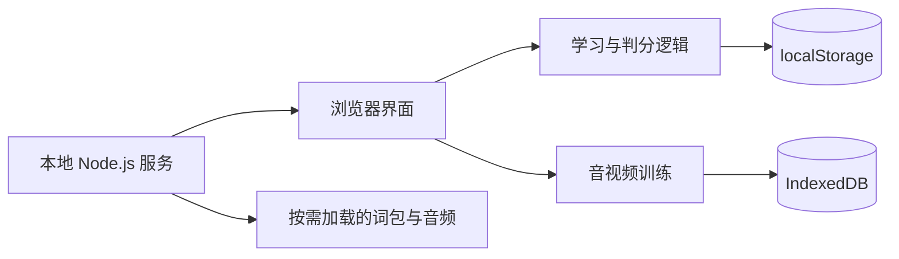

<div align="center">


# 英格雷斯 · Englace

**让英语，成为你的底气。**

面向中国英语学习者的本地学习空间。<br />
从高考到大学、从考试到真实语境，把词汇积累、间隔复习和听力训练连成日常。

[](https://github.com/Rose-ZG/englace/actions/workflows/check.yml)


[快速开始](#快速开始) · [实用功能](#实用功能) · [技术栈](#技术栈) · [数据与备份](#数据与备份) · [开发与验证](#开发与验证)

</div>

---

## 项目概览

### v0.4 词汇训练工作台

| 模式 | 实用功能 |
| :--- | :--- |
| 词汇树 / 知识图谱 / 关系网 | 24 个精选词族；节点可点击、键盘选择；标注词形、派生、近反义及主题关系，区别本区词汇与拓展词 |
| 拼写提取 / 词义配对 | 10 词主动拼写、5 词配对；答错加入当前考试分区的间隔复习 |
| 词境跃迁 | 原创横向避障跳跃，随时间加速，支持方向键、A/D、空格与触屏按钮 |
| 穿隙飞行 | 原创窄隙飞行，空格或点击振翅，难度逐渐提高 |
| 学习复活 | 失败后先学习、再正确拼写最多 5 个本区词才能接续分数；优先到期复习；允许随时退出或清零重开 |

游戏支持暂停、失焦暂停、分区最佳分数和可关闭的合成音效。图谱使用 SVG、游戏使用 Canvas 与 `requestAnimationFrame`，无需新增运行时依赖或网络请求。词汇训练已移除听力卡片，听力功能在侧栏独立保留。

关系图是人工编排的教学关系，尚非全词库自动语义图。游戏最佳分数以考试方向和游戏类型分别存储于本机浏览器，不包含在学习/工作室备份内；学习复活产生的单词掌握及复习记录包含在学习备份内。

英格雷斯将不同考试方向划分为独立学习区，围绕「学词 → 复习 → 听力 → 反馈」构建轻量学习流程。无需注册账号，学习进度保存在当前电脑的浏览器中；应用通过本地服务运行，核心学习流程不调用云端 AI 服务。

界面沿用黑白双主题，以留白、细线、低饱和绿和克制的动效建立视觉层次。README 顶部直接引用网站使用的 [`favicon.svg`](./favicon.svg)，保持品牌一致。

| 6 个独立学习区 | 每区 3,674–6,974 词 | 19 篇原创听力 | 43 道听力练习题 |
| :---: | :---: | :---: | :---: |
| 各区进度独立 | 词包按需加载 | 本地合成音频 | 作答后即时解析 |

> 当前版本为 **v0.4.0 MVP**，适合体验与迭代验证。内置训练不等同于完整官方题库、正式模考或专业测评。

### v0.3 · 从记忆，走向表达

| 新模块 | 可直接使用的能力 |
| :--- | :--- |
| 写作工坊 | 六区共 12 项原创任务，题型提示、结构提纲、草稿自动保存、词数与本地结构检查；可选 LLM 修改建议 |
| 口语练习 | 六区共 10 项原创任务，准备与表达计时、录音回听下载、手动转写、自评；可选 AI 文本表达建议 |
| 每日打卡 | 每日一次、连续天数、28 天日历、1,085 条公版摘句、出处链接、收藏与原创意境配图 |
| 在线影视 | Blender 官方 Sintel 预告片、B 站官方嵌入播放器、自备双语字幕与可调区域遮罩 |
| 专属伙伴 | 六种矢量风格、自然语言配色造型、本地图片、拖动与点击学词；可选 LLM 图像理解与 OpenAI 文生图 |
| 学习空间 | 按「今日 / 专项学习 / 探索与陪伴」分组的侧栏，插画词库卡片与轻量动效 |

网页模式提供**应用内悬浮伙伴**；可选桌面模式提供真正的透明置顶桌宠，可在其他窗口上方拖动、学词，并与桌面学习窗口同步进度。OpenAI 文生图生成单张外观图，不生成多帧动画。在线功能默认不主动发送内容；配置、数据流与验证限制见 [联网与隐私说明](./docs/PRIVACY.md)。

## 快速开始

### 环境要求

- **Node.js 20 或更高版本**，包含 npm。
- 支持 `localStorage`、`IndexedDB` 和现代音视频播放的浏览器。
- 使用有权访问本私有仓库的 GitHub 账号克隆。

### 克隆与运行

```bash
git clone https://github.com/Rose-ZG/englace.git
cd englace
npm start
```

在浏览器中打开 **[http://127.0.0.1:4173](http://127.0.0.1:4173)**。

**无需执行 `npm install`，也无需配置数据库、API Key 或登录系统。** 仓库已包含可运行的词包和听力音频。

Windows 用户也可以在安装 Node.js 后，双击根目录的 **`启动英格雷斯.cmd`**，启动脚本会打开浏览器。升级后请先停止旧服务，再重新启动；单纯刷新网页不会重载 Node 后端。使用完毕后，在运行服务的终端按 `Ctrl+C` 停止服务。

> 请通过本地 HTTP 服务访问，直接双击 `index.html` 无法正常加载词库与听力数据。建议固定使用同一浏览器和同一地址，避免产生彼此隔离的学习记录。

### 第一次学习

1. 在侧边栏选择目标，如「大学英语四级」或「雅思」。
2. 从「单词实验室」开始一组词卡，根据掌握情况安排后续复习。
3. 在「听力空间」选择题型，先盲听作答，再核对原文和解析。
4. 如需学习自己的教材词表或影视对白，进入「词库书架」或「影视精听」导入素材。
5. 定期通过侧边栏导出学习备份。

### 可选：运行桌面桌宠

```bash
npm run desktop
```

桌面启动器需要 **Node.js 22.12+**。首次通过 npm 下载固定版本 Electron 44.9.0，之后使用本机 npm 缓存；若项目 `.cache/electron-runtime` 已有验证过的本地运行时则优先使用。网页模式不需要下载它。桌面学习窗口与透明置顶桌宠使用独立的本地服务 `127.0.0.1:4174` 与专用 Electron 数据目录。拖动桌宠顶部或外观即可移动，按钮可以翻面、朗读、掌握单词并同步学习窗口。关闭学习窗口会保留已显示的桌宠，桌宠底部「退出」可结束整个桌面程序。

桌面模式与普通浏览器的存储档案不同，已有网页进度可通过学习备份和工作室备份迁移；本版尚未制作 `.exe` 安装包。运行时关闭页面 Node 权限、启用上下文隔离与沙箱，只通过白名单 IPC 暴露有限窗口操作；外部网页不能使用该桥接能力。

## 实用功能

### 01 · 按目标隔离的学习空间

不同学习区使用各自的词包，单独保存掌握状态、复习计划、学习时长、词汇练习与听力成绩。切换方向不会把其他区的成绩计入当前区。

| 学习方向 | 内置词数 | 听力训练内容 |
| :--- | ---: | :--- |
| 高考英语 | 3,674 | 短对话、长对话、独白 |
| 大学英语四级 · CET-4 | 3,846 | 短篇新闻、长对话、听力篇章 |
| 大学英语六级 · CET-6 | 5,406 | 长对话、听力篇章、讲座 / 讲话 |
| 雅思 · IELTS | 5,040 | 表格填空、用途匹配、多项选择、笔记填空 |
| 托福 · TOEFL 2026 | 6,974 | 应答选择、对话、公告、学术讲座 |
| 考研英语 | 4,801 | 面向复试的研究经历与学术理解 |

词包依据 ECDICT 上游考试标签筛选，跨区存在词汇重合，**不能相加视为独立单词总数**，也不代表最新官方考纲的完整覆盖。高考听力按地区存在差异；考研统考英语初试不含听力，本项目考研听力面向复试。题型依据见 [内容来源说明](./docs/SOURCES.md)。

### 02 · 词汇学习与间隔复习

- **查找更快**：英文与中文释义搜索、掌握状态筛选、个人词库切换，每页展示 24 词。
- **主动回忆**：10 词一组，先回想再翻面，查看音标、中英文释义及词表中已有的例句。
- **分次巩固**：未掌握的词在 10 分钟后进入到期复习；掌握后按 1、2、4 天逐步延长间隔，上限 30 天。
- **练习闭环**：从当前词库抽取词义选择题，提交后即时反馈，答错词加入当前区的复习计划。
- **按需朗读**：使用浏览器语音接口朗读单词；可用性取决于浏览器和系统英语语音配置。

### 03 · 能持续扩充的词库书架

内置词包可直接学习或导出，也可以把个人课程、教材册次、单元词汇整理成独立词库。

| 输入形式 | 支持能力 |
| :--- | :--- |
| CSV / TSV | 解析双语词表，支持表头映射、引号与多行字段 |
| JSON | 导入词条数组，或包含 `words` 数组的对象 |
| TXT | 从文本中提取英文，并匹配当前分区内置词包 |
| 专业词典与教材 | 提供牛津、朗文、人教版等官方入口，支持导入已获授权的词表 |

导入前可预览有效词条，系统按英文单词去重，并保存到当前学习区。界面提供 CSV 模板下载。

<details>
<summary><strong>查看最小词表格式</strong></summary>

推荐使用 UTF-8 编码，至少包含 `word` 和 `meaning`；`translation` 也可用作中文释义列名。

```csv
word,meaning,phonetic,example,exampleTranslation
approach,方法；接近,əˈprəʊtʃ,A practical approach makes learning easier.,一种实用的方法让学习更轻松。
```

```json
{
  "words": [
    {
      "word": "approach",
      "meaning": "方法；接近",
      "phonetic": "əˈprəʊtʃ",
      "example": "A practical approach makes learning easier.",
      "exampleTranslation": "一种实用的方法让学习更轻松。"
    }
  ]
}
```

TXT 匹配不会为内置词库以外的单词自动生成释义。目前不支持直接解析 PDF、扫描件或 MDX。

</details>

### 04 · 分级听力训练

按学习方向和题型组织 **19 篇原创材料、43 道练习题**，配套已生成的本地 WAV 音频。

- 支持选择、匹配、多选和填空，提交后显示参考答案与中文解析。
- 支持重听与 `0.75× / 1× / 1.25× / 1.5×` 倍速播放。
- 可隐藏原文，或逐句查看、朗读；答题前显示原文会标记为辅助练习。
- 保存本区累计作答统计，以及每篇材料最近一次的成绩。

内置音频使用系统英语语音合成，不代表真人多口音训练；题目为原创专题练习，不模拟官方题量、播放限制、自适应路径或考试分数。

### 05 · 本地影视精听

把有权使用的英美剧、电影或其他音视频素材变成自己的精听练习。

```text
导入音视频 + SRT 字幕 → 选择对白 → 设置起止点 → 循环精听 → 听写校对 / 跟读
```

支持字幕按句定位、虚拟片段截取、循环播放、倍速、隐藏字幕与听写文本对照；没有字幕时也可手动填写一句对白。内置一段**原创对白示例**，无需准备素材即可体验。

媒体存于当前浏览器的 IndexedDB，不上传到 GitHub。此模块不提供剧集下载、内置商业影视台词、自动语音识别或裁剪视频导出。

新增「在线影视」入口，点击后才连接 Blender 官方预告片或 B 站官方播放器。原生播放器支持自备双语 SRT 时间同步；B 站播放器跨域，不能读取内部字幕，采用可调整位置和高度的中英文区域遮罩，不伪装成平台字幕开关。平台可用性、版权和地区限制仍适用。

### 06 · 可 DIY 的辅学伙伴

可以设置伙伴名称、交流风格和学习目标。伙伴会结合当前区的词库、掌握记录、到期复习与听力作答情况，提供学习计划、复习建议和词汇查询。

默认是**离线规则助手**。在伙伴工作室填写服务商、准确模型 ID 和本机会话 API Key 后，可以选择 OpenAI、DeepSeek 或阿里云百炼的联网辅学。支持当前消息问答、写作建议、手动口语转写建议，以及有视觉能力模型的参考图理解。服务商或模型不支持某种输入时会返回错误，不伪造模型结果。

外观可以直接选用光球、猫咪、小狐、机器人、猫头鹰、软糖精灵，或上传本地图片；自然语言可以驱动本地造型配置，也可由 LLM 理解描述和参考图后返回安全的造型配置。可选 OpenAI 图像模型接口会按文字描述生成一张真实图片，需另填已开通的 GPT Image 模型 ID 并确认计费。配置不含预置密钥。

密钥只存在本机 Node 服务内存，停止服务后清除。每次联网前需在对应功能确认发送；不自动发送录音、学习档案或全部历史。AI 建议不是官方评分，口语功能不做真实发音评测。

### 07 · 为专注设计的交互

黑白主题、响应式布局、词卡与听力卡片交互、答对光晕、答错轻微振动和合成提示音。音效可独立关闭；动画尊重系统的 `prefers-reduced-motion` 设置。

## 技术栈

| 层级 | 技术 | 用途 |
| :--- | :--- | :--- |
| 页面与交互 | HTML5、原生 JavaScript | 页面渲染、词卡、练习、学习状态与路由切换 |
| 视觉与适配 | CSS3、CSS 自定义属性、媒体查询 | 黑白主题、响应式布局、动画与减少动态效果适配 |
| 业务逻辑 | 独立 `core.js` 模块 | 数据迁移、词表解析、复习调度、听力判分、SRT 解析 |
| 轻量数据存储 | `localStorage` | 分区进度、个人词库、主题、音效设置与伙伴设定 |
| 媒体存储 | `IndexedDB`、Blob URL | 本地音视频保存与播放 |
| 音视频能力 | HTML Audio / Video、Web Audio API、SpeechSynthesis | 听力播放、片段循环、答题音效与按需朗读 |
| 本地服务 | Node.js 内置 `http` / `fs` / `path` | 静态文件服务、音频 Range 请求与资源访问范围限制 |
| 词库构建 | Python 标准库 `csv` / `json` / `hashlib` | 清洗上游 CSV、生成词包与来源校验摘要 |
| 听力资源构建 | Node.js、PowerShell、Windows SAPI | 原创题库生成与本地 WAV 音频合成 |
| 自动验证 | Node.js Test Runner、GitHub Actions | 核心逻辑、数据完整性、服务行为与持续检查 |
| 可选智能服务 | 服务端 `fetch`、OpenAI 兼容 Chat Completions、OpenAI Images API | 会话密钥内存托管、同源校验、输入限制、错误脱敏与显式发送确认 |

应用没有运行时第三方 npm 依赖。用户启动不需要 Python 或 PowerShell；这两者仅用于开发阶段重建资源。

### 运行结构



本地服务仅监听 `127.0.0.1:4173`。首页不预载所有音频，词包按当前学习区加载，词汇列表分页展示；媒体服务支持 Range 请求，便于跳转播放位置。上述设计用于减少启动和渲染负担，尚无跨设备性能基准。

## 数据与备份

| 数据 | 保存位置 | 学习 JSON 备份是否包含 |
| :--- | :--- | :---: |
| 六个分区的学习、复习、作答记录 | `localStorage` | 是 |
| 个人导入词库 | `localStorage` | 是 |
| 主题、音效和伙伴设定 | `localStorage` | 是 |
| 写作草稿、口语手动转写、打卡与外观配置 | 独立工作室 `localStorage` | 使用**工作室备份**另行导出 / 恢复 |
| 伙伴上传图 / AI 外观图 | 工作室 `localStorage` | 否；可单独导出外观图片 |
| 本次口语录音 | 页面内存 Blob URL | 否；可手动下载录音 |
| API Key | 本机 Node 服务内存 | **永不包含** |
| 导入的音视频与关联字幕 | `IndexedDB` | **否** |
| 内置词包与原创听力音频 | 仓库静态文件 | 无需包含 |

通过侧边栏导出或恢复 v2 学习备份；恢复会替换现有学习进度和个人词库。v1 备份会迁移到对应方向，旧「四六级」记录归入四级区。

**请另外保留原始音视频和字幕文件。** 清理浏览器数据、切换浏览器、使用不同站点地址或隐私浏览模式，都可能造成记录隔离或丢失。当前不提供跨设备同步、账号恢复或应用级数据加密。

| 资源限制 | 当前上限 |
| :--- | :--- |
| 单个词表导入 | 20 MB / 20,000 个有效词条 |
| 单个媒体文件 | 500 MB |
| 字幕文件 | 2 MB |
| 实际可保存容量 | 以浏览器存储配额为准 |

应用本地学习流程无需云端账号。LLM / 图像生成仅在配置后主动使用时调用服务商，可能按服务商条款计费。浏览器朗读是否完全离线取决于所选语音实现；打开词典入口、在线影片与 B 站播放器会连接外部网站。用户导入的数据不写入项目源码，也不随 Git 提交上传。

## 项目结构

```text
englace/
├── index.html                 # 应用入口与导航
├── favicon.svg                # 网站与 README 共用 logo
├── style.css                  # 基础样式与主题
├── upgrade.css                # 分级词库、听力及影视模块样式
├── app.js                     # 界面、交互与本地存储编排
├── core.js                    # 可独立验证的业务逻辑
├── learning.js                # 写作口语任务、工作室校验与外观配置逻辑
├── features.js                # 表达训练、打卡、在线影视与悬浮伙伴界面
├── features.css               # 工作室视觉、插画书架与伙伴动效
├── ai-server.js               # 可选智能服务与本机密钥管理
├── assets/                    # 六套原创意境与书架矢量插画
├── server.js                  # 仅监听本机的静态服务
├── desktop/                   # 可选 Electron 主进程与受限 preload 桥接
├── desktop-pet.*               # 透明置顶桌宠页面、学词逻辑与样式
├── package.json               # 启动与检查命令
├── 启动英格雷斯.cmd            # Windows 启动入口
├── data/                      # 六区词包、听力题库、来源摘要与许可证
├── audio/                     # 19 个原创听力合成音频
├── scripts/                   # 词包、题库与音频构建脚本
├── tests/                     # 核心逻辑与服务测试
├── docs/
│   ├── SOURCES.md             # 内容来源、题型依据与能力边界
│   └── VALIDATION.md          # 版本验证记录
└── .github/workflows/         # 持续检查配置
```

## 开发与验证

### 常用命令

| 命令 | 作用 |
| :--- | :--- |
| `npm start` | 启动本地服务 |
| `npm run desktop` | 可选 Electron 桌面窗口与透明置顶桌宠，首次需联网获取运行时 |
| `npm run check` | 检查应用、核心逻辑与服务端 JavaScript 语法 |
| `npm test` | 运行核心逻辑、词包、听力资源与 HTTP 服务测试 |

当前测试覆盖分区隔离、v1 数据迁移、复习间隔、词表解析、无效备份、听力判分、SRT 时间轴、词包与音频完整性、Range / HEAD 请求及私有文件访问限制。GitHub Actions 在推送与 Pull Request 时执行检查。

浏览器验证范围与尚未覆盖的兼容性场景见 [验证记录](./docs/VALIDATION.md)。测试通过不代表所有浏览器、媒体编码或大体积文件场景均已验证。

<details>
<summary><strong>重建词包与听力资源</strong></summary>

普通使用者无需执行本节命令。

**词包构建**：准备 ECDICT 上游 `ecdict.csv`，保存在忽略目录 `.cache/`，然后执行：

```bash
python scripts/build_vocab.py .cache/ecdict.csv
```

脚本按考试标签筛选、去重、排序，生成六个 JSON 词包，并在 `data/manifest.json` 中记录词数、大小与上游文件的 SHA-256。

**听力题库**：

```bash
node scripts/build_listening.js
```

**听力音频**：需要 Windows、PowerShell 7 和可用的系统英语 SAPI 语音包。

```powershell
pwsh -File scripts/build_audio.ps1
```

音频输出为 16 kHz、16-bit、单声道 WAV。重建文本后，应同步重建音频并重新检查文本、音频与题目的一致性。

</details>

### 提交变更

保持源码、词包与资源构建脚本一致；提交前运行 `npm run check` 和 `npm test`。修改界面时检查黑白主题、窄屏布局与减少动态效果设置。

不要提交凭据、`.env`、个人学习备份、上游原始大文件或用户影视素材。默认忽略规则见 [`.gitignore`](./.gitignore)。

## 常见问题

<details>
<summary><strong>启动后无法加载词库，或页面提示加载失败？</strong></summary>

确认通过 `npm start` 或启动脚本运行，保持终端开启，并访问 `http://127.0.0.1:4173`。不要使用 `file://` 直接打开 HTML。若端口已占用，先确认是否已有英格雷斯服务运行。

</details>

<details>
<summary><strong>为什么换了浏览器或地址后，学习记录不见了？</strong></summary>

浏览器按站点来源隔离存储。例如 `localhost` 与 `127.0.0.1` 对应不同来源。回到原浏览器和原地址，导出学习备份，再在新环境导入；媒体需要单独重新导入。

</details>

<details>
<summary><strong>为什么朗读不可用，或某个视频无法播放？</strong></summary>

单词和逐句朗读依赖浏览器与系统英语语音包。内置听力使用仓库中的 WAV 文件，不依赖实时语音合成。用户视频的可播放性取决于编码和浏览器支持，可优先尝试浏览器兼容的 MP4、WebM、MP3 或 WAV。

</details>

<details>
<summary><strong>是否包含牛津、朗文完整词典或真实影视片段？</strong></summary>

不包含。当前提供官方来源入口与本地导入能力，商业内容应通过合法授权获取。内置词汇来自 ECDICT，听力文本和题目为本项目原创。

</details>

## 来源与使用说明

- **词汇数据**：来自 [ECDICT](https://github.com/skywind3000/ECDICT)，按上游声明的 MIT 许可保留 [原始许可证](./data/ECDICT-LICENSE.txt)。其多来源汇编数据可能存在释义或标签错误；上游许可声明不等同于商业出版商授权。
- **听力内容**：本项目原创文本与题目，配套合成音频；不含官方真题、商业教材原文或影视台词。
- **第三方素材**：仅导入你有权使用的词表、字幕和媒体；不要把未获授权的内容提交到仓库。
- **项目许可**：当前仓库尚未单独声明项目代码的开源许可证。ECDICT 的许可仅适用于对应第三方数据，不能据此推定整个项目采用 MIT。

完整说明见 [内容来源与题型依据](./docs/SOURCES.md)。

## 版本记录

| 版本 | 内容 |
| :--- | :--- |
| [`v0.4.0`](https://github.com/Rose-ZG/englace/tree/v0.4.0) | 写作口语、打卡名句、在线影视、专属悬浮伙伴与可选 LLM / 图像接口 |
| [`v0.2.0`](https://github.com/Rose-ZG/englace/tree/v0.2.0) | 分级词库、间隔复习、分级听力、本地影视精听与答题反馈 |
| [`v0.1.0`](https://github.com/Rose-ZG/englace/tree/v0.1.0) | 初始 MVP、黑白主题、12 个示例词、基础练习与 DIY 伙伴 |

详见 [CHANGELOG](./CHANGELOG.md)。

---

<div align="center">

**一点一滴，让世界更近一点。**<br />
<sub>ENGLACE · ENGLISH, WITH EASE.</sub>

</div>
